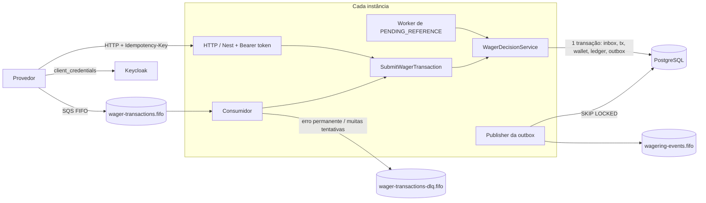

# Arquitetura

Aqui eu explico as decisões que tomei no projeto e o porquê de cada uma. A ideia principal foi: **quem garante que o dinheiro está certo é o PostgreSQL**. A aplicação faz as regras, mas se por algum bug ela tentar gravar um saldo errado, o banco recusa.

## Sumário

1. [Visão geral](#1-visão-geral)
2. [Organização do código](#2-organização-do-código)
3. [Money](#3-money)
4. [ORM e transações](#4-orm-e-transações)
5. [Concorrência](#5-concorrência)
6. [Regras no banco](#6-regras-no-banco)
7. [Idempotência](#7-idempotência)
8. [Estados da transação](#8-estados-da-transação)
9. [Regras de negócio e interpretações](#9-regras-de-negócio-e-interpretações)
10. [Contratos: HTTP status e failureCode](#10-contratos-http-status-e-failurecode)
11. [Referências fora de ordem](#11-referências-fora-de-ordem)
12. [Consumidor SQS](#12-consumidor-sqs)
13. [Outbox](#13-outbox)
14. [Observabilidade](#14-observabilidade)
15. [Teste de carga](#15-teste-de-carga)
16. [Autenticação](#16-autenticação)
17. [Testes](#17-testes)
18. [Limitações](#18-limitações)

---

## 1. Visão geral



Todas as instâncias rodam o mesmo código: API, consumidor, publisher da outbox e worker de referências. Não tem instância "líder" nem nada guardado em memória que precise ser compartilhado. Quando as instâncias precisam se coordenar, isso acontece pelo banco, com lock de linha, índices únicos e `FOR UPDATE SKIP LOCKED`.

## 2. Organização do código

| Pasta | O que tem |
|---|---|
| `domain/` | `Money`, `Wallet`, `WalletLedgerEntry`, `WagerTransaction`, inbox, outbox e eventos. Não importa Nest nem MikroORM. |
| `application/` | Casos de uso, o `WagerDecisionService` (as regras) e as interfaces (portas) de repositório, unit of work, relógio e métricas. |
| `infrastructure/` | MikroORM (schemas, migrations, repositórios), SQS, logger, métricas e workers. |
| `interface/` | Entrada de dados: controllers HTTP, consumidor SQS e validação com zod. |

Algumas escolhas:

- As entidades têm construtor privado e são criadas por métodos estáticos. `create`/`open` validam as regras; `rehydrate` só monta o objeto com o que veio do banco. Se alguém tenta mudar uma transação que já terminou, dá erro, porque isso seria bug.
- HTTP e SQS chamam **o mesmo caso de uso** (`SubmitWagerTransaction`). A única diferença é que o SQS passa os dados da inbox.
- Todas as regras de BET/WIN/LOSS/REFUND/ROLLBACK ficam no `WagerDecisionService`, num lugar só.
- Cada erro tem uma categoria (validação, não encontrado, conflito, transitório). Uma função só (`error-classification.ts`) decide o status HTTP e se a mensagem do SQS leva ack, retry ou vai para a DLQ. Assim o HTTP e a fila sempre tratam o mesmo erro do mesmo jeito.
- Os casos de uso são classes normais. O Nest só monta as dependências no `app.module.ts`, o que deixa os casos de uso fáceis de testar.

## 3. Money

- Guardo o valor como `bigint` em centavos, com escala fixa de 2 casas. Assim não uso `number` em nenhum lugar e a conta é sempre exata: somar `0.01` mil vezes dá `10.00` certinho, e tem teste para isso.
- A leitura do valor é bem rígida e **nunca arredonda**. Só aceito o formato `^(0|[1-9]\d{0,15})(\.\d{1,2})?$`, então `NaN`, `Infinity`, `1e3`, `""`, `-1.00`, `1,00`, `01.00`, `.5` e `10.005` são rejeitados. Achei melhor recusar do que arredondar, porque arredondar esconderia um erro do provedor.
- `Money.from` não aceita valor negativo, porque o contrato manda só o valor e quem diz se é débito ou crédito é o tipo da operação. O `Money.fromSigned` só é usado internamente, na diferença da reconciliação.
- `Money` é imutável: cada operação retorna um objeto novo (com `Object.freeze`). Somar moedas diferentes lança `CurrencyMismatchError`.
- No banco as colunas são `NUMERIC(20,2)`. O MikroORM devolve esse valor como string, e eu converto com `Money.from`. O domínio não conhece nenhum tipo do ORM.
- O modelo aceita várias moedas (uma wallet por player e moeda). Não tratei moedas com outro número de casas, como JPY (0) e KWD (3), porque o desafio fixa 2 casas.

## 4. ORM e transações

Escolhi o **MikroORM 6**, que era a opção preferida no desafio. Os motivos:

- `em.fork()` + `em.transactional()` deixam explícito que cada operação tem a sua própria unit of work. Desliguei o contexto global (`allowGlobalContext: false`) para não ter um EntityManager compartilhado entre requests.
- Com `LockMode.PESSIMISTIC_WRITE` / `PESSIMISTIC_READ` consigo fazer `FOR UPDATE` / `FOR SHARE` sem escrever SQL na mão.
- Com `EntitySchema` eu mapeio classes de persistência separadas das entidades do domínio. Assim o domínio não precisa de decorators, e os repositórios convertem de um para o outro.

Como usei o MikroORM em cada caso:

| Operação | Como | Por quê |
|---|---|---|
| Inserts (transação, ledger, outbox, wallet) | `em.create`, com flush no commit | usa a unit of work normalmente |
| Atualizar saldo | `nativeUpdate ... WHERE id = ? AND version = ?` | quem decide se o update vale é o banco |
| Mudar status da transação | `nativeUpdate ... WHERE id = ? AND status = ?` | só muda se ainda estiver no status esperado |
| Inbox | `INSERT ... ON CONFLICT DO NOTHING RETURNING` | dedup em uma operação só |
| Pegar mensagens da outbox | `UPDATE ... WHERE id IN (SELECT ... FOR UPDATE SKIP LOCKED)` | não tem isso na API normal |
| Ler dentro da transação | `findOne(..., { refresh: true })` | sem isso o identity map podia devolver um dado velho depois de esperar um lock |

Cada operação é **uma transação em READ COMMITTED**, com `lock_timeout` e `statement_timeout`. Deixei as foreign keys como `DEFERRABLE INITIALLY DEFERRED`, então a ordem em que o MikroORM faz os inserts não importa e tudo é checado no `COMMIT`.

## 5. Concorrência

A unidade de concorrência é a **wallet**. Usei três camadas de proteção:

1. **Lock na linha da wallet** (`SELECT ... FOR UPDATE`) antes de qualquer coisa que mexa no saldo. Quem quer mexer na mesma wallet espera na fila; wallets diferentes não se bloqueiam (não existe lock global).
2. **Checagem de versão** no `UPDATE` (`WHERE version = ?`). Com o lock isso não deveria falhar nunca. Se falhar é bug, e o erro vira retry em vez de sobrescrever o saldo em silêncio.
3. **O banco recusa estado errado**: `CHECK (saldo >= 0)`, trigger que exige `version + 1` a cada mudança de saldo, e trigger que exige lançamento no ledger (detalhes na seção 6).

**Por que lock pessimista e não só otimista?** Em cassino é muito comum a mesma wallet receber várias operações seguidas (BET e WIN da mesma rodada, rajadas de bônus). Com otimista puro, quando muitas operações disputam a mesma linha quase todas falham e precisam tentar de novo, e isso só piora com mais carga. Com o lock elas simplesmente esperam a vez.

**Por que não SERIALIZABLE?** Também funcionaria, mas o banco ia abortar transações com frequência e o retry viraria o caminho normal. Com o lock explícito o comportamento ficou mais previsível.

Outros detalhes:

- **Busco de novo depois de pegar o lock.** A busca pela idempotency key acontece antes do lock, como atalho para replays, e é repetida depois. Em READ COMMITTED cada query vê o que já foi comitado, então se uma requisição duplicada terminou enquanto eu esperava o lock, eu enxergo. É isso que faz "50 iguais em paralelo resultarem em um débito só".
- **Os locks são sempre na mesma ordem: primeiro a wallet, depois a transação.** Vale para o fluxo normal e para o worker de referências, e evita deadlock entre eles.
- **`lock_timeout` de 3 s** para ninguém ficar preso para sempre numa wallet muito disputada. Se estourar, é erro transitório: tenta de novo algumas vezes e, se não der, devolve `503` no HTTP ou faz retry na fila. Isso aparece na métrica `wagering_lock_conflicts_total`.
- **Retry limitado** (`withTransientRetry`, 3 tentativas). Cada tentativa é uma transação nova, então repetir é seguro.
- O FIFO do SQS com `MessageGroupId = walletId` ajuda, porque diminui a disputa e mantém a ordem, mas **a correção não depende dele**. Nos testes eu mando operações da mesma wallet por HTTP e por SQS ao mesmo tempo, em 3 instâncias.

**Um bug que os testes de concorrência pegaram:** eu procurava a transação por idempotency key e depois por `externalTransactionId`, em duas queries. Às vezes a requisição duplicada comitava bem entre as duas: a primeira não achava nada, a segunda achava, e o código entendia que era "mesmo id com outra key" e devolvia um `409` errado. A correção foi comparar a key da linha encontrada. Coloquei um teste de unidade que simula essa situação e rodei o cenário de 50 em paralelo 3.000 vezes sem erro.

## 6. Regras no banco

Tudo isso está na migration `src/infrastructure/persistence/migrations/Migration20261014000001_initial_schema.ts`. O arquivo `test/integration/schema.test.ts` testa cada regra com SQL direto, sem passar pela aplicação.

| O que garante | Como |
|---|---|
| Dinheiro exato | `NUMERIC(20,2)` |
| Uma wallet por player e moeda | `UNIQUE (player_id, currency)` |
| Saldo nunca negativo | `CHECK (balance_amount >= 0)` (e também em `balance_after`) |
| `version` sobe 1 só quando o saldo muda | trigger `wallet_guard` |
| Toda mudança de saldo tem lançamento no ledger | trigger adiada `wallet_matches_ledger`: no `COMMIT`, a versão atual da wallet precisa ter um lançamento com o mesmo saldo |
| Todo lançamento corresponde a uma mudança de saldo | trigger adiada `ledger_matches_wallet` + `UNIQUE (wallet_id, wallet_version)` |
| Conta do lançamento fecha | `CHECK (balance_after = balance_before ± amount)` |
| Ledger encadeado | trigger `ledger_chain_guard`: o `balance_before` de um lançamento é o `balance_after` do anterior, as versões não pulam e a moeda é a da wallet |
| Ledger não pode ser alterado | triggers bloqueiam `UPDATE`, `DELETE` e `TRUNCATE` |
| Um lançamento por transação e wallet | `UNIQUE (transaction_id, wallet_id)` |
| Idempotência | `UNIQUE (idempotency_key)` e `UNIQUE (provider_id, external_transaction_id)` |
| Reverter só uma vez | índice único parcial em `reference_transaction_id` para REFUND/ROLLBACK processados |
| REFUND/ROLLBACK precisam de referência; OPENING é só interno | `CHECK`s |
| Transação terminada não muda; campos de negócio não mudam; não pode deletar | trigger `wager_tx_guard` |
| `REJECTED`/`FAILED` sempre com `failure_code` | `CHECK` |
| Inbox sem duplicata | `PRIMARY KEY (consumer_name, message_id)` |
| Outbox não muda depois de gravada | trigger `outbox_guard` |

Na prática, se alguém fizer `UPDATE wallets SET balance_amount = ...` sem criar o lançamento no ledger, o `COMMIT` falha.

Índices que criei para as consultas mais usadas:
- `(wallet_id, wallet_version)` no ledger, usado pelo encadeamento e pela paginação;
- índices parciais nas transações `PENDING_REFERENCE`, usados pelo worker;
- `next_attempt_at` na outbox onde `published_at IS NULL`, usado pelo publisher.

As migrations têm `up` e `down` (os dois são testados) e ficam listadas explicitamente na configuração.

## 7. Idempotência

- O header `Idempotency-Key` é a fonte da verdade. O formato recomendado é `{providerId}:{externalTransactionId}`. No SQS a key vem em `data.idempotencyKey`.
- O **`payloadHash`** é um SHA-256 de um JSON canônico, com as chaves ordenadas, sem espaços e sem campos `undefined`. Ele cobre só os campos de negócio: `providerId`, `externalTransactionId`, `playerId`, `walletId`, `roundId`, `gameId`, `kind`, `money` e `referenceExternalTransactionId` (`null` quando não vem).
  - O valor é normalizado antes do hash, então `"25"`, `"25.0"` e `"25.00"` dão o mesmo hash.
  - O header, o `messageId`, o `occurredAt` e o `correlationId` não entram no hash.
- O que acontece em cada caso:

  | Caso | Resultado |
  |---|---|
  | Mesma key e mesmo payload | replay: mesma resposta, com `idempotentReplay: true` (também vale para `REJECTED`) |
  | Mesma key e payload diferente | `409 IDEMPOTENCY_KEY_CONFLICT` |
  | Mesmo `externalTransactionId` com outra key | `409 EXTERNAL_TRANSACTION_ID_CONFLICT` |
  | Mesmo `messageId` no SQS com outro payload | `INBOX_MESSAGE_CONFLICT` e vai para a DLQ |
  | Replay de uma transação `PENDING_REFERENCE` | tento resolver a referência na hora |

- Para o replay devolver o saldo da época, salvo em cada transação o saldo logo depois de processá-la (`observed_balance_amount`), inclusive quando ela é rejeitada.
- Não tem cache em memória: quem garante a idempotência é o índice único no banco.

## 8. Estados da transação

```
             create()
                │
                ▼
            PENDING ──────────────► PROCESSED   (final)
                │  └──────────────► REJECTED    (final, com failureCode)
                │  └──────────────► FAILED      (final, com failureCode)
                ▼
      PENDING_REFERENCE ──────────► PROCESSED | REJECTED | FAILED
                │  ▲
                └──┘ scheduleReferenceRetry()  (continua no mesmo status, tentativas + 1)
```

- `PENDING` é o estado inicial, só em memória. A transação é criada e decidida dentro da mesma transação SQL, então no fluxo normal ela nunca fica salva como `PENDING`.
- `PROCESSED`, `REJECTED` e `FAILED` são finais. Tentar mudar daí dá erro no domínio e também no banco (trigger).
- `REJECTED` é quando uma regra de negócio não passa. `FAILED` existe para erro permanente de infraestrutura que precisa ficar registrado (código `PROCESSING_ERROR`). Hoje nenhum fluxo marca `FAILED`: erro transitório faz retry e erro permanente vai para a DLQ sem gravar nada. Preferi assim porque marcar `FAILED` por um erro que poderia passar sozinho travaria aquela idempotency key para sempre.

## 9. Regras de negócio e interpretações

| Operação | Saldo | Ledger | Regra |
|---|---|---|---|
| `BET` | debita | 1 `DEBIT` | `INSUFFICIENT_FUNDS` se não tiver saldo |
| `WIN` | credita | 1 `CREDIT` | referência opcional; se vier, tem que ser uma `BET` válida |
| `LOSS` | não muda | nada | fica `PROCESSED` sem ledger e sem mudar `version` |
| `REFUND` | credita | 1 `CREDIT` | só sobre `BET` processada, com o mesmo valor |
| `ROLLBACK` | o contrário da referência | 1 lançamento invertido | sobre `BET`, `WIN` ou `REFUND` processados, com o mesmo valor |

Onde o enunciado deixava dúvida, decidi assim:

1. **Uma transação só pode ser revertida uma vez no total**, seja por `REFUND` ou por `ROLLBACK`. O enunciado fala "pelo mesmo tipo de operação", mas se eu permitisse um `REFUND` e um `ROLLBACK` na mesma `BET`, o jogador receberia o dinheiro duas vezes. Fui pelo lado mais seguro e garanti isso com um índice único. Ainda dá para fazer `ROLLBACK` de um `REFUND`, porque o `REFUND` é outra transação.
2. A referência precisa ser do mesmo provider, player, wallet, moeda e rodada. Se não for, a resposta é `REFERENCE_MISMATCH`.
3. Se a referência existe mas ainda não terminou (por exemplo, também está esperando a própria referência), a transação fica em `PENDING_REFERENCE` até a referência terminar.
4. Se a referência terminou `REJECTED` ou `FAILED`, a resposta é `REFERENCE_NOT_PROCESSED`, porque não tem o que reverter.
5. Uma reversão que deixaria o saldo negativo (por exemplo, `ROLLBACK` de um `WIN` depois de o jogador já ter gastado) retorna `REVERSAL_WOULD_OVERDRAW`. É um código diferente de `INSUFFICIENT_FUNDS` porque é uma situação diferente: precisa de alguém da operação olhar.
6. `LOSS` aceita valor `0.00`; as outras operações precisam de valor maior que zero.
7. Player que não é dono da wallet gera `PLAYER_WALLET_MISMATCH`, e moeda diferente da wallet gera `CURRENCY_MISMATCH`. As duas ficam salvas como `REJECTED`, para auditoria.
8. Se a wallet não existe, não salvo nada (não tem wallet para ligar a transação): devolve `404` no HTTP e manda para a DLQ no SQS.
9. `BET` não pode ter referência, e uma transação não pode referenciar ela mesma.
10. `OPENING` e o provider reservado `__internal__` não podem ser enviados de fora. Isso é validado na entrada e também no banco.

## 10. Contratos: HTTP status e failureCode

Todos os endpoints usam o mesmo mapeamento (`interface/http/error.filter.ts`). Os erros vêm no formato `{ "error": { "code", "message", "retryable", "details?", "correlationId" } }`.

| HTTP | Quando | Pode reenviar? |
|---|---|---|
| `201` | transação nova processada | — |
| `200` | replay (mesma resposta, `idempotentReplay: true`) | — |
| `202` | `PENDING_REFERENCE`: aceita, mas vai ser aplicada depois | sim, com a mesma key |
| `422` | `REJECTED` por regra de negócio, com `failureCode` | não com a mesma key, o resultado já é final |
| `400` | payload, parâmetro ou header inválido | só depois de corrigir |
| `401` | sem token, token inválido ou expirado (`WWW-Authenticate: Bearer`) | sim, com um token novo |
| `403` | token válido, mas sem permissão (outro provider ou sem role) | não |
| `404` | wallet ou transação não existe | não |
| `409` | conflito de idempotência ou wallet já existe | não |
| `503` + `Retry-After` | erro temporário (banco fora, lock timeout) | sim, com a mesma key |
| `500` | erro inesperado | sim, com a mesma key (nada fica aplicado pela metade) |

Os `failureCode` (definidos em `domain/wagering/failure-code.ts`):

| failureCode | Significado | O que o provedor faz |
|---|---|---|
| `INSUFFICIENT_FUNDS` | aposta maior que o saldo | não reenviar |
| `REVERSAL_WOULD_OVERDRAW` | `ROLLBACK` deixaria o saldo negativo | falar com a operação |
| `CURRENCY_MISMATCH` | moeda diferente da wallet | corrigir e mandar com novo id |
| `PLAYER_WALLET_MISMATCH` | player não é dono da wallet | corrigir e mandar com novo id |
| `REFERENCE_NOT_FOUND` | a referência não chegou a tempo | falar com a operação |
| `REFERENCE_INVALID_KIND` | tipo de referência não permitido (ex.: `REFUND` de `WIN`) | corrigir e mandar com novo id |
| `REFERENCE_MISMATCH` | referência de outra rodada, player, wallet, moeda ou provider | corrigir e mandar com novo id |
| `REFERENCE_NOT_PROCESSED` | a referência foi rejeitada ou nunca terminou | não reenviar |
| `REFERENCE_ALREADY_REVERSED` | a referência já foi revertida | não reenviar |
| `REFERENCE_AMOUNT_MISMATCH` | valor diferente do da referência (reversão parcial não é suportada) | corrigir e mandar com novo id |
| `PROCESSING_ERROR` | erro permanente de infraestrutura (`FAILED`) | falar com a operação |

## 11. Referências fora de ordem

- Se a referência ainda não existe, salvo a transação como `PENDING_REFERENCE`, publico o evento `WagerTransactionPendingReference` e respondo `202`.
- Cada instância roda um worker (`ResolvePendingReferences`) que procura as transações cujo próximo horário de tentativa já passou. Para cada uma ele faz lock na wallet, lê a transação de novo e tenta resolver. Se outra instância já resolveu, ele pula. Tem teste com três workers ao mesmo tempo para garantir que a resolução acontece uma vez só.
- **Backoff exponencial com jitter:** 1 s, 2 s, 4 s... até no máximo 5 min, com **10 tentativas**. Dá uma janela de uns 14 minutos, que achei suficiente para atrasos normais de rede e de fila. Quando as tentativas acabam, a transação vira `REJECTED` com `REFERENCE_NOT_FOUND` (ou `REFERENCE_NOT_PROCESSED`, se a referência existe mas nunca terminou) e o evento é publicado. Esses valores são configuráveis.
- Quando uma transação termina, as transações que estavam esperando por ela têm a próxima tentativa adiantada para agora. Assim não precisam esperar o backoff.
- Se o provedor reenviar uma transação que está em `PENDING_REFERENCE`, eu já tento resolver na hora (sem contar como tentativa).

## 12. Consumidor SQS

Arquivo `interface/sqs/wager-consumer.ts`:

- **Dedup pela inbox** com a chave `(consumerName, messageId)`, usando o `messageId` do envelope (que não muda quando o produtor reenvia), e não o `MessageId` do SQS. Gravo a inbox **na mesma transação** que o resto. Então, se existe linha na inbox, a mensagem já foi processada. Se dois consumidores pegarem a mesma mensagem, o `INSERT ... ON CONFLICT` do segundo espera o primeiro terminar e vira duplicata.
- O **ack** (`DeleteMessage`) só acontece depois do commit. Se o processo morrer entre os dois, a mensagem volta para a fila e a inbox impede o processamento duplicado. Testei isso matando o processo de verdade (`process.exit(137)`).
- Como trato cada tipo de resultado:

  | Tipo | Exemplos | O que faço |
  |---|---|---|
  | Negócio | `PROCESSED`, `REJECTED`, `PENDING_REFERENCE` | ack |
  | Transitório | banco fora, lock timeout, deadlock, erro inesperado | não dou ack e aumento a visibilidade com backoff (`base × 2^(n−1)`) |
  | Permanente | JSON inválido, schema inválido, `OPENING`, wallet inexistente, conflito de idempotência | mando direto para a DLQ |

- **Limite de tentativas:** quando chega no `maxReceiveCount`, o próprio consumidor manda a mensagem para a DLQ com o motivo nos atributos (`failureReason`, `errorCode`, `receiveCount`). Também configurei a `RedrivePolicy` da fila com `maxReceiveCount + 2`, como segurança caso o processo morra antes de decidir.
- **FIFO:** separo o lote por `MessageGroupId`. Mensagens do mesmo grupo vão uma por vez; grupos diferentes vão em paralelo.
- **SIGTERM:** o consumidor para de buscar mensagens, termina as que já começou e devolve para a fila (`VisibilityTimeout = 0`) as que ainda não tinha começado. Existe um tempo máximo para isso (`SHUTDOWN_GRACE_MS`). Depois param os outros workers e, por último, o ORM.

## 13. Outbox

- Os eventos (`WagerTransactionProcessed`, `WagerTransactionRejected`, `WalletBalanceChanged` e `WagerTransactionPendingReference`) são gravados na tabela `outbox_messages` **na mesma transação** que o resto. Então nenhum evento é publicado antes do commit.
- O envelope é a classe abstrata `IntegrationEvent<T>`, com uma subclasse para cada evento. O `eventType` e a `version` ficam na própria classe. O `data` leva o dinheiro como string (`MoneyProps`), nunca o objeto `Money`.
- O publisher funciona com várias instâncias ao mesmo tempo:
  1. Pega um lote numa transação curta, marcando `locked_until` e `locked_by` com `FOR UPDATE SKIP LOCKED`. Duas instâncias nunca pegam a mesma linha ao mesmo tempo.
  2. Publica no SQS fora da transação, com `SendMessageBatch` em paralelo, usando `MessageDeduplicationId = eventId`.
  3. Marca como publicado ou agenda nova tentativa com backoff.
- Se o processo morrer entre o passo 2 e o 3, o `locked_until` expira e outra instância publica de novo. Então o evento pode sair duplicado, mas sempre com o mesmo `eventId`, e o consumidor consegue ignorar a cópia. Tem teste para isso e para o caso "comitou e morreu antes de publicar".
- Não garanto a ordem dos eventos entre instâncias diferentes. Quem consome pode usar o `walletVersion` (que vai no `WalletBalanceChanged`) para ordenar.
- Métricas: `outbox_lag_seconds`, `outbox_pending_messages`, `outbox_published_total` e `outbox_publish_failures_total`.

## 14. Observabilidade

- **Logs em JSON**, uma linha por evento. Cada linha leva `service`, `instanceId` e o contexto da requisição ou mensagem (via `AsyncLocalStorage`): `correlationId`, `messageId`, `transactionId`, `walletId` e `providerId`. O `correlationId` vem do header `X-Correlation-Id`, ou é gerado, e volta na resposta.
- **Nada sensível nos logs:** o logger esconde campos como `amount`, `balance`, `money`, `payload`, `body`, `data` e `authorization`. Só ficam ids e resultados.
- **Métricas Prometheus** em `GET /metrics`:

  | Métrica | O que mede |
  |---|---|
  | `wagering_transactions_total{kind,status,source}` | transações por status |
  | `wagering_duplicates_total{type,source}` | duplicatas detectadas |
  | `wagering_retries_total{operation,reason}` | retries |
  | `sqs_dlq_messages_total{reason}`, `sqs_messages_total{outcome}` | DLQ e consumo |
  | `wagering_lock_conflicts_total` | conflitos de lock |
  | `outbox_lag_seconds`, `outbox_pending_messages` | atraso da outbox |
  | `wagering_processing_duration_seconds{source}` | latência |
  | `wallet_reconciliations_total{result}` | reconciliações |

- **Health:** `/health/live` só responde que o processo está de pé, sem checar o banco (assim uma queda do banco não reinicia a aplicação). `/health/ready` checa o PostgreSQL e o SQS. Os dois são abertos, sem autenticação.
- **Reconciliação:** `POST /wallets/:id/reconciliation` soma créditos menos débitos do ledger (com `FOR SHARE` na wallet, para ninguém mudar no meio da conta) e compara com o saldo salvo. Se der diferença, gera log de erro, incrementa a métrica e retorna `consistent: false`. **Não corrijo nada automaticamente.**

## 15. Teste de carga

Comando: `bun run test:load`. Como funciona:

- sobe 3 instâncias de verdade;
- dispara 64 clientes HTTP ao mesmo tempo por 20 s;
- roda dois perfis: BETs de `0.01` espalhadas em 200 wallets, e todas as BETs numa wallet só;
- mede latência, status das respostas, conflitos de lock (pelas métricas) e o atraso da outbox (consultado a cada 250 ms);
- no final, confere o ledger de todas as wallets.

**Ambiente:** i9-12900KF (24 threads), 31 GB, Linux, Docker 29, PostgreSQL 17 em container, MiniStack 1.5.27 e Bun 1.4.3. Tudo na mesma máquina.

| Perfil | Req | Throughput | p50 | p95 | p99 | máx | Erros | Lock conflicts | Atraso máx. da outbox |
|---|---:|---:|---:|---:|---:|---:|---:|---:|---:|
| 200 wallets | 20.533 | 1.021 req/s | 46 ms | 136 ms | 165 ms | 229 ms | 0 % | 0 | 12,2 s |
| 1 wallet | 1.324 | 64 req/s | 644 ms | 2.885 ms | 4.686 ms | 5.557 ms | 0 % | 0 | 28,6 s* |

Conferência final: **0 diferenças** entre saldo e ledger nas 201 wallets.

O que eu concluí:

- **Com uma wallet só, o limite é o tempo do `fsync` do commit, não o código.** Medi um `INSERT` + `COMMIT` simples nesse volume Docker: **11,2 ms com `synchronous_commit=on`** e 0,6 ms com `off`. Como cada aposta na mesma wallet espera o commit da anterior, o máximo fica em torno de 1 / (11 ms + ~4 ms) ≈ 65 por segundo, que foi o que medi.
  - **Não** desliguei o `synchronous_commit`, porque com dinheiro não dá para perder transação confirmada se o banco cair.
  - Num disco melhor (NVMe ou RDS, com commit de 1 a 2 ms) esse número deve subir bastante.
- O p95/p99 alto na wallet única é fila: 64 clientes esperando o mesmo lock. Nenhuma requisição falhou nem estourou o `lock_timeout`. Parte da espera também é por conexão do pool (64 clientes para 45 conexões, 15 por instância).
- **Com várias wallets escala bem:** cerca de 1.000 por segundo com p99 de 165 ms.
- **Atraso da outbox:** com ~1.000 transações por segundo (~2.000 eventos por segundo) o publisher fica para trás e alcança depois do pico. Na primeira versão o atraso chegou a 14 s. Mandar os batches em paralelo e aumentar o lote para 200 reduziu para 7 a 12 s. Para melhorar mais, daria para buscar o próximo lote enquanto publica o atual, ou ter instâncias só para publicar.

\* Inclui eventos que sobraram do primeiro perfil.

## 16. Autenticação

Segui a orientação do desafio de usar um Identity Provider externo em vez de fazer autenticação na mão. Usei o **Keycloak**, que sobe no compose. O realm (clients, secrets, claims e roles) é importado de `docker/keycloak/wagering-realm.json` quando o container sobe. A API não guarda usuário nem senha.

Como funciona:

1. Cada provedor é um client OAuth2 confidencial e pede o token com `client_credentials`. Configurei no Keycloak dois mappers em cada client: um coloca o claim `provider_id` no token e o outro coloca `aud = wagering-api`.
2. Para facilitar, a API tem `POST /auth/token`. Ele recebe `clientId` e `clientSecret` (no body ou em HTTP Basic), repassa para o endpoint de token do Keycloak e devolve `{ access_token, token_type: "Bearer", expires_in }`. Quem cria e assina o token continua sendo o Keycloak. Secret errado devolve `401`; Keycloak fora do ar devolve `503`.
3. Nas rotas protegidas, o `AuthGuard` global usa o `OidcProviderIdentity` para validar o `Authorization: Bearer ...` com a lib `jose`. Ele confere a assinatura com as chaves públicas do Keycloak (JWKS), o `iss`, o `aud` e o `exp`. As chaves ficam em cache, então não tem chamada ao Keycloak a cada request.
4. Autorização:
   - um provedor só pode enviar transação com o próprio `providerId`; outro `providerId` dá `403`;
   - um provedor só consulta as próprias transações; a role `operator` consulta todas;
   - `POST /wallets/:id/reconciliation` exige a role `operator` (client `backoffice`);
   - `/health/*`, `/metrics` e `/auth/token` são públicos (`@Public()`).
5. Mensagens do SQS não usam token, porque o desafio trata a fila como canal interno confiável. As regras de domínio (player dono da wallet, referência do mesmo provider etc.) continuam valendo.

Detalhes que precisei acertar:
- O Keycloak monta o `iss` a partir da URL usada para pedir o token. As instâncias em Docker chamam `keycloak:8080`, e quem está fora chama `localhost:8080`. Para os tokens terem sempre o mesmo `iss`, configurei `KC_HOSTNAME=http://localhost:8080` com `KC_HOSTNAME_BACKCHANNEL_DYNAMIC=true`. A aplicação recebe separadamente o issuer esperado (`AUTH_ISSUER`) e as URLs internas do JWKS e do token.
- Com `AUTH_ENABLED=false` a autenticação é desligada (o `NoopProviderIdentity` libera tudo). A maioria dos testes roda assim para focar na parte financeira; a autenticação tem testes próprios.

Os secrets do realm (`provider-a-secret` etc.) são só para desenvolvimento. Em produção eles viriam de um cofre de segredos, e o Keycloak teria banco próprio em vez do modo `start-dev`.

## 17. Testes

- **Unidade (73):** `Money`, `Wallet`, `WagerTransaction`, todas as regras da seção 9 (usando um repositório falso em memória), idempotência (incluindo o caso do bug da seção 5), inbox, outbox, backoff e validação do JWT (assinatura, issuer, audience e expiração, com chaves geradas no teste).
- **Integração (59):** PostgreSQL, SQS e Keycloak de verdade.
  - Cada regra do banco testada com SQL direto, e as migrations `down`/`up`.
  - Atomicidade: se der erro no meio, nada fica salvo pela metade.
  - HTTP: todos os status e a paginação.
  - Consumidor: dedup pela inbox, DLQ, retry de verdade (segurando um lock em outra conexão), DLQ depois de muitas tentativas e shutdown.
  - Outbox: 3 publishers ao mesmo tempo, crash depois de publicar e falha do SQS.
  - Referências pendentes: resolução, limite de tentativas e vários workers ao mesmo tempo.
  - Autenticação: token pelo `/auth/token`, `401` sem token, `403` para outro provider e para reconciliação sem a role `operator`.
- **Concorrência (9):** sobe **3 processos de verdade** da aplicação. Testa o crash depois do commit e antes do ack, e mata as 3 instâncias com SIGKILL no meio da carga. Depois de reiniciar, confere que nada foi perdido nem duplicado e que o ledger bate.
- Para esperar coisas assíncronas usei uma função `eventually(...)` com prazo, em vez de `sleep` fixo. O único `sleep` é para esperar de propósito um `locked_until` de 200 ms expirar. Cada arquivo de teste usa suas próprias filas e limpa o banco antes. Rodei a suíte várias vezes seguidas sem falha.

## 18. Limitações

- Uma wallet muito disputada fica limitada pelo `fsync` (seção 15). Uma melhoria seria processar várias mensagens da mesma wallet numa transação só.
- Todas as moedas usam 2 casas decimais.
- A ordem dos eventos publicados não é garantida entre instâncias. Quem consome usa o `walletVersion`.
- As tabelas de inbox e outbox crescem sem limite. Faltaria um job para apagar registros antigos (a inbox precisa guardar por mais tempo que a janela de reentrega do SQS).
- O status `FAILED` existe, mas nenhum fluxo usa hoje (seção 8).
- Não fiz ledger de partidas dobradas (era opcional). O ledger tem uma entrada por movimentação da wallet, e o banco confere o encadeamento.
- O Keycloak roda em modo `start-dev`, com secrets fixos no realm. Serve para desenvolvimento, não para produção (seção 16).
- OpenTelemetry não foi feito. Os logs já têm o `correlationId` de ponta a ponta.
